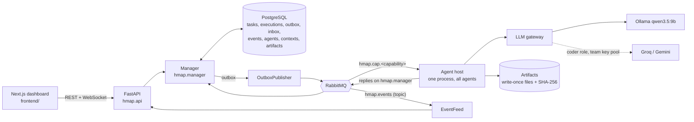
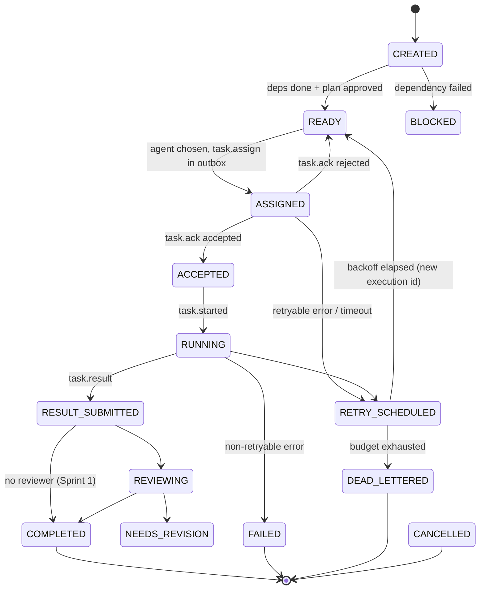
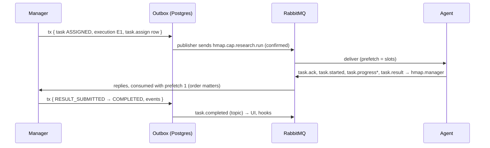
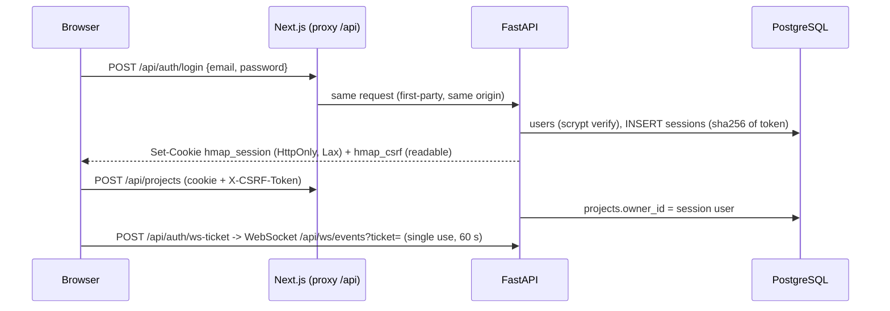

# Design — Member 1: communication layer, Manager core, platform skeleton

## 1. Components

| Module (`backend/src/hmap/`) | Responsibility |
|---|---|
| `core/contracts/` | Envelope + 15 message payloads, domain events, cross-member contracts, JSON Schema export, examples, `CAPABILITY_OUTPUTS` |
| `core/bus/` | `Bus` interface; `InMemoryBus` (tests) and `RabbitBus` (demo) with identical semantics; outbox publisher; inbox dedup; Postgres outbox/inbox stores |
| `core/llm/` | Gateway (roles, modes live/record/replay/fake, schema-constrained JSON + repair, replay cache, cloud key pool) |
| `core/runtime/` | `BaseAgent`, `AgentWorker` (lifecycle, registration, heartbeats, dedup, progress, cancellation), plug-in discovery, `hmap-agents` host |
| `core/plugins.py` | `Plugin`, `@hook`, strategy slots (`executor`, `recovery`, `llm_provider`) |
| `manager/` | transition table, task store (memory/Postgres), assignment, retries, watchdog, DAG executor, hooks, approval gate |
| `services/` | registry, context store, artifact store (memory/Postgres/local FS) |
| `db/` | psycopg 3 async pool (`Database`), table models, Alembic migration `001`, migrate-on-start |
| `api/` | REST routers, `EventFeed`, WebSocket `/api/ws/events` |
| `agents/stubs`, `agents/pipeline` | canned agents for every capability; upload → extract → plan → approval hooks |
| `system.py` | composition root (`HMAP_BUS`, `HMAP_STORE`) |

## 2. Task state machine (`manager/transitions.py`)

Project level: a project either waits in AWAITING_APPROVAL for a human, or, with `auto_approve`, records an
automatic approval and goes straight to EXECUTING (the plan is still stored and shown). **Stop**
(`Manager.stop_project`) cancels every unfinished task in one transaction:
- in-flight executions are marked CANCELLED and agents receive `task.cancelled`;
- pending approvals are rejected;
- the project moves to CANCELLED;
- afterwards `create_task` / `submit_graph` raise `ProjectStopped`, so late hooks cannot restart work.

Out-of-order replies are tolerated (`ASSIGNED → RUNNING/RESULT_SUBMITTED` allowed). Terminal states never change.
Every transition is a compare-and-swap on `state_version` and writes its domain event to the outbox in the same
transaction. A report from a non-active (superseded) execution is stored as evidence and changes nothing.

Agent lifecycle (`core/runtime/lifecycle.py`): STARTING → REGISTERING → AVAILABLE ⇄ BUSY → DRAINING → OFFLINE, plus
RECOVERING (registration retry) and FAILED. The registry marks an agent OFFLINE when its lease expires; its executions
get a grace period, then are retried as new executions.

## 3. Message flow of one task

## 4. Bus topology (`core/bus/rabbitmq.py`)

| Name | Type | Purpose |
|---|---|---|
| `hmap.commands` → `hmap.cap.<capability>` | direct exchange → durable queues | work for agents, competing consumers |
| `hmap.manager` | durable queue | agent → Manager reports |
| `hmap.events` | topic exchange | domain events; durable named subscribers or temporary ones |
| `hmap.retry` → `hmap.retry.<ms>ms.<queue>` | direct exchange → TTL queues | delayed redelivery to the original queue only |
| `hmap.dlx` → `hmap.dlq` | fanout → queue | exhausted / rejected messages with reason + history (no automatic replay) |

Headers: `x-hmap-kind`, `x-hmap-attempt`, `x-hmap-history`. Publisher confirms, persistent messages, manual ack.
Retry = publish copy (attempt + 1) and confirm, then ack the original (never loses, may duplicate → inbox dedup).
Consumer loss = broker requeue with `redelivered=True` and the same attempt.

## 5. Database (`alembic/versions/001_sprint_1_core.py`)

`projects`, `documents`, `tasks`, `executions` (unique `(task_id, attempt)`), `approvals`, `messages`, `inbox`
(PK `(consumer_id, message_id)`), `outbox` (identity `seq`, partial index on unpublished), `events` (append-only,
trigger rejects UPDATE/DELETE), `agents` (lease, GIN index on capabilities), `contexts` (PK `(context_id, version)`),
`artifacts` (PK `(artifact_id, version)`), `errors`. Records with many fields keep filter columns + a `jsonb` copy.
Outbox rows are inserted last in their transaction under an advisory lock, so `seq` order = commit order.
Migrations run on start (`hmap.db.upgrade_async`); each later sprint adds one file `0NN_sprint_<n>_*.py`.

## 6. Failure handling

| Failure | Detection | Handling |
|---|---|---|
| Agent crash mid-task | unacked delivery returns to the queue; lease expiry | redelivered to another agent; or OFFLINE → grace → new execution |
| Duplicate delivery | inbox `(consumer, message_id)` | acked and skipped |
| Result after timeout / from superseded execution | execution guard | kept as evidence, no state change |
| Retryable error (network, timeout, model, rate limit) | error taxonomy (`core/errors.py`) | RETRY_SCHEDULED, backoff 5/30/120 s + jitter, new execution id |
| Retries exhausted | attempt counter | DEAD_LETTERED + event; dependants BLOCKED; DLQ visible at `/api/dead-letters` |
| Non-retryable error (invalid input, auth, wrong result) | taxonomy | FAILED; dependants BLOCKED |
| Manager crash after commit, before publish | unpublished outbox rows | publisher sends them after restart (tested on Postgres) |
| Broker restart | robust connection | durable queues survive; tested: 20/20 messages, no loss |
| Out-of-order / late replies | transition table + versions | stale reports recorded, no regression |
| Schema mismatch | `schema_version` major | `SCHEMA_UNSUPPORTED`; registration negotiates versions |
| Artifact tampering | SHA-256 on every read | `ARTIFACT_INTEGRITY` error |
| Cloud key rate-limited / revoked | 429 / 401 | key cool-down / disabled, next key, then local model |

## 6b. Accounts, ownership and runs

**Accounts** (`services/accounts/`): users, sessions and reset tokens, stored in memory or in Postgres (migration
`001b`).
- Passwords: scrypt (N=2^15, r=8, p=1) with a random salt.
- Sessions and reset tokens: random 32 bytes; only SHA-256 hashes are stored. Sessions last 14 days and slide
  forward with use; reset tokens last 30 minutes and work once.
- Rate limits on login, register and reset.
- Login and reset errors do not reveal whether an account exists.

**Ownership is the API's job** (`api/routers/projects.py: owned_project`). Every project-scoped route loads the
project and compares `owner_id` with the session user. Unknown, deleted or someone else's project all return the
same 404. The event REST endpoint and the WebSocket filter by owned projects (`ProjectAccess`), and dead letters are
filtered by the `project_id` in their body. Plug-in routers are mounted behind the session dependency.

**Runs:** `Manager.start_run` appends a `RunRecord` and moves the project to INGESTING. Tasks are stamped with the
run number, and the project's outcome is decided over the current run's tasks only. A failure while INGESTING
settles the run as FAILED. Stop marks the run CANCELLED. A finished or stopped project can be run again.

**Delete:** stops active work, sets `deleted_at` (hidden from every API) and erases the artifact files
(`ArtifactStore.delete_project`). Records stay as the audit trail.

## 7. Design decisions worth knowing

- **One Manager per database.** Replies are consumed with prefetch 1 and the Postgres store keeps a local lock; a
  second Manager process would need per-task ordering (not needed for a single-laptop demo).
- **Agents in one process.** Same bus semantics, ~1–2 GB less RAM than one container per agent.
- **Commands go to capability queues**, not to one agent: the Manager's chosen agent is advisory; whichever agent
  acks first is recorded.
- **No registration reply yet:** an agent becomes AVAILABLE after sending `agent.register`; if the registry rejects
  it (e.g. unsupported schema version) the agent is not told, and because it still consumes its capability queue it
  could pick up work. Fine with one team-controlled agent host; an `agent.registered` reply is a planned improvement.

## 8. Configuration

`.env.example` documents everything: `HMAP_BUS`, `HMAP_STORE`, `HMAP_RABBITMQ_URL`, `HMAP_DATABASE_URL`
(Postgres on host port **5433**), `HMAP_ARTIFACT_ROOT`, `HMAP_PLUGINS`, `HMAP_LLM_MODE`, `HMAP_ROLE_MAP`,
`OLLAMA_BASE_URL`, team key pool (`HMAP_GROQ_API_KEYS`, `HMAP_GEMINI_API_KEYS`, `HMAP_CLOUD_ROLE_MAP`, `HMAP_CLOUD_OK`).
