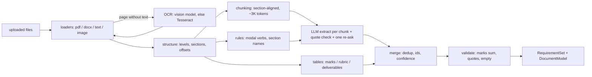

# Design — Member 2: document intelligence

## 1. Interfaces
- **Input:** `TaskAssign` for `document.extract`, created by Member 1's `pipeline` plug-in on upload.
  `artifact_refs` = the uploaded documents (type `document`); `inputs["documents"]` = `[{artifact_id, name,
  folder, path}]` in upload order (absent for a typed request: one `text/plain` document, named `request.txt`).
- **Output:** `TaskResult(outcome="success", artifact_refs=[requirement-set, document-model])`.
  - `requirement-set`: `RequirementSet` (`backend/src/hmap/core/contracts/schemas/domain/RequirementSet.schema.json`).
  - `document-model`: `DocumentModel` (`agents/doc_intel/model.py`): every document's pages, blocks with page,
    bounding box, section path and text offsets, and tables. Used by the source view in the UI.
- **Event:** `project.requirements_ready {project_id, task_id, requirement_set_ref}`, emitted by the plug-in's hook on
  `task.completed` for `document.extract`. The `pipeline` plug-in still starts `plan.generate` (no duplicate hook).
- **Contract change (additive, snapshot accepted):** `SourceRef.folder` keeps the upload folder ("Part A").
- **Guarantees for Member 3** (spec §7): every requirement has an id, text, type, priority, `source_ref` and
  confidence. `total_marks` is set only when the criteria add up to it. `open_questions` lists what a person
  should check.

## 2. Components

| Module (`backend/src/hmap/agents/doc_intel/`) | Role |
|---|---|
| `loaders/` | `pdf.py` (pdfplumber words -> lines -> blocks; columns, header/footer, notes, tables; OCR gate), `docx.py` (styles, lists, tables), `text.py` (Markdown/plain), `__init__.py` (type detection by content, OCR of flagged pages and images) |
| `ocr.py` | vision model (`ctx.llm.read_images`, cached by image hash) first, Tesseract second, a warning if neither |
| `structure.py` | heading levels from font-size rank and numbering depth; section paths; block ids; text offsets |
| `tables.py` | marks/rubric/deliverables tables -> criteria with level marks, merged cells filled down; stated totals in prose |
| `chunking.py` | section-aligned chunks; skips headers, footers, footnotes and rule-read tables |
| `extract/rules.py` | keyword pre-pass (hints, confidence boost, fallback) |
| `extract/llm.py` | prompt v2, `ChunkExtraction` schema, re-ask for unfound quotes, per-chunk cache |
| `extract/quotes.py` | normalised exact / approximate / unverified quote lookup |
| `merge.py` | dedup (same quote or Jaccard >= 0.8), document-order ids, confidence |
| `validate.py` | marks sum, rubric levels <= maximum, quotes, empty set -> issues and questions |
| `pipeline.py` | the steps above, progress, cancellation; shared by the agent, tests and eval |
| `agent.py` / `router.py` / `plugin.py` | `DocIntelAgent`, the API, the plug-in + event hook |
| `frontend/src/features/doc_intel/` | Requirements tab: list by folder, confidence, edit/add/remove, save as a version, source view |

## 3. Data structures
- `Block{id, type: heading|paragraph|list_item|table|note|header|footer, text, page, bbox (0..1), level,
  section_path, char_start, char_end, table_id, ocr}`; `TableModel{id, block_id, rows, kind}`;
  `PageInfo{number, width, height, ocr, ocr_engine, ocr_confidence}`.
- `SourceRef{doc_id, page, block_ids, char_span (into SourceDocument.text), quote, folder}`.
- Confidence: table-read 0.95; LLM item with exact quote 0.90 (+0.05 when the rules agree); approximate quote
  0.70; unverified 0.40; rules-only 0.60; human-added 1.0.

## 4. Algorithms / prompts
- **Role** `reasoner`, temperature 0, seed 7, JSON schema `ChunkExtraction` (repair by the gateway). With the team
  keys it runs on Gemini 3.6 Flash first; locally on `qwen3.5:9b`. Role `vision` (Gemini only) for OCR.
- **Prompt v2** (`extract/llm.py`): definitions of requirement / constraint / deliverable with examples, one item
  per sentence, quote character for character, skip background and marks tables, list ambiguities as questions.
  The rule hits go in as hints.
- **Checked by code, not by the model:** marks, totals and rubric levels (tables), quote existence, ids, section
  structure, OCR gating, deduplication.
- **Repair:** schema errors -> gateway repair loop; quotes not found -> one re-ask for those items; model error ->
  that chunk falls back to rules and the set says so.

## 5. Failure modes
| Failure | Detection | Handling |
|---|---|---|
| Corrupt / encrypted file | loader exception | warning -> open question; other documents still processed |
| Scan, no OCR available | page flagged, no engine | warning "no OCR is available ... brew install tesseract" -> open question |
| Model down / quota gone / garbage | `HmapError` / `httpx` error | rules-only for that chunk, confidence 0.6, open question |
| Invented requirement | quote not in source | re-ask once; else confidence 0.4 + question |
| Marks do not add up | sum != stated total | `total_marks` withheld, question with both numbers |
| Duplicate across chunks | same quote / Jaccard | dedup keeps the most confident |
| Cancelled run | `ctx.check_cancelled` between steps | `Cancelled` propagates |
| Redelivered task | inbox dedup (runtime) | plus in-process cache of OCR and chunk answers |
| Stale human edit | `base_version` != latest | 409, nothing saved |

## 6. Configuration
No new environment variables. Uses `HMAP_LLM_MODE`, the team key pool (`vision` route added to the default cloud
role map) and `HMAP_CLOUD_OK` / the per-project "Keep on this computer" switch: a local-only project never sends a page
image or a chunk to the cloud. System dependency: `tesseract` (optional, for local OCR).
