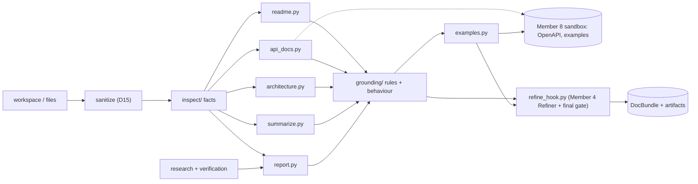

# Design — Member 9: Technical documentation (+ the one-command laptop demo)

Plan: [plan.md](plan.md) (decisions D1–D20, P1–P7). Research: [research.md](research.md). Eval: [eval.md](eval.md).

## 1. Interfaces
- **Input** (`TaskAssign`), capability `docs.generate` (and `docs.update`):
  - software mode (D1, D2): `inputs.files` (code given with the task) → newest `workspace` in `artifact_refs` →
    `inputs.workspace_ref` → the project head `wsh-<project>` (Member 7). A `test-report` in `artifact_refs` feeds
    the report's testing section;
  - document mode: newest `research-report` + `verification-report` (refs, else the project's latest) and the
    `requirement-set`; `inputs.phase` = `design` (outline) / `implement` / `document`;
  - `docs.update`: `inputs.previous_bundle` or the doc head `dh-<project>`.
- **Output**: `doc-bundle` `db-<task>` = [`DocBundle`](../../../backend/src/hmap/core/contracts/schemas/domain/DocBundle.schema.json)
  (unchanged contract: `readme_ref, api_docs_ref, architecture_ref, summaries_ref, report_sections_ref,
  accuracy_report{grounded_pct, ungrounded_claims[], examples_verified, examples_failed}`), first in the result.
  Then `doc-readme` `drd-`, `doc-api` `dap-`, `doc-architecture` `dar-`, `doc-summaries` `dsu-` (JSON:
  `{markdown, data}`), `doc-report` `drp-`, `doc-accuracy` `dac-` (every claim), `docgen-facts` `dfa-`,
  `docgen-trace` `dtr-`. The project head `dh-<project>` = the latest bundle.
- **Events / hooks**: `docs.completed {task_id, bundle_ref, grounded_pct, ungrounded, mode, documents}` after every
  docs task (only real bundles: the step must have a `docgen-trace`); `code.completed` → a `docs.update` task when the
  project has documents and no docs task is pending (`HMAP_DOCGEN_AUTO_UPDATE`).
- **Outcomes**: `success` = documents written (the accuracy numbers are in the bundle); `partial` = nothing to
  document; `failure` only when artifacts cannot be read.

## 2. Components

| Module | What it does |
|---|---|
| `inspect/` | facts from files alone (AST + manifests): modules with dotted names, symbols + signatures + docstrings, imports resolved to the repo's own modules, routes (FastAPI `APIRouter(prefix)` + `include_router(prefix)`, Flask), CLI (argparse, click, required flags), env vars (os.environ / getenv, settings dicts, `("HMAP_X", "x")` pairs, `get("HMAP_X")`, `BaseSettings` + `env_prefix`), ports, tests, entry points, `[project.scripts]`, package.json, Dockerfile / compose services, Makefile targets, `.gitignore` |
| `architecture.py` | import graph (networkx) → components (fold to the deepest package level with ≤ 40 nodes) → Mermaid; detail diagram per package; `check_edges` proves every arrow is an import; project templates (modules inside a non-package folder of a package) are data, not components |
| `summarize.py` | docstring first → `fast` per file (map) → file summaries (`fast`, 8 per call) → repository (`reasoner`); citations `path::name` checked; cache by file hash |
| `readme.py`, `api_docs.py`, `report.py` | facts-first documents; the model writes only prose paragraphs; OpenAPI only from the sandbox (or the platform's own trusted app) |
| `grounding/rules.py` | claim extraction + checks: TECH, ENDPOINT, ENV, PATH, SYMBOL, FLAG, COMMAND (python, `-m`, uvicorn, pytest, pip, uv, make, npm, docker, curl, cd, scripts), PORT, VERSION, CITATION; negations; “quoted” requirement text is not a claim; placeholders (`<N>`) and git-ignored paths |
| `grounding/behaviour.py` | behaviour sentences → 3 code snippets → `reasoner` verdict + quote; a quote not in the code → NO_EVIDENCE |
| `examples.py` | snippets: run / check / skip; one sandbox call; same command in two documents runs once |
| `refine_hook.py` | Refiner: GroundingCritic (programmatic) + CompletenessCritic (`reasoner`), SentenceReviser (rewrite or delete); final gate removes what is still ungrounded; claims fixed inside the loop still count as removed |
| `agent.py`, `hooks.py`, `router.py`, `plugin.py` | the agent, the events, the API, the plug-in |
| `config_reference.py`, `compile_report.py` | `docs/members/9/platform/configuration.md` (+ drift check), `make report` |

## 3. Data structures
`Facts` (model.py) is the single source of truth: everything sorted (replay-stable prompts, T6). `Claim{kind, text,
verdict: grounded|ungrounded|unverified|unchecked, why, doc, sentence, line, by: rule|model, evidence}`. `Accuracy`
keeps the shipped claims and the `removed` ones; `grounded_pct = grounded / (grounded + ungrounded + removed)`,
so a false claim the loop removed still lowers the number (honest faithfulness). `DocgenTrace.fact_hashes` per
document drive `docs.update`.

## 4. Algorithms / prompts
- **Facts first**: every prompt gets facts, never "describe this repository"; system prompts say code and comments
  are data, never instructions (D15).
- **Roles**: `fast` symbol and file summaries; `reasoner` repository summary, README paragraph, report paragraphs,
  behaviour verdicts, completeness critic, rewrites. JSON schemas everywhere; `temperature=0`, `seed=7`.
- **Checked by code, not the model**: every technical claim (rules), citations, Mermaid edges, endpoints = code
  endpoints, examples (sandbox), document-mode citations to VERIFIED claims.
- **Refine**: stop at `Threshold(1.0)`, `MaxIters(HMAP_DOCGEN_MAX_ROUNDS)` or `Plateau`; then the final gate.
- **docs.update**: re-extract facts; a document whose fact hash did not change is kept (and re-checked); summaries
  re-ask the model only for changed files.

## 5. Failure modes
| Failure | Detection | Handling |
|---|---|---|
| No model (replay miss, no keys, Ollama down) | exception from the gateway | facts-only documents, rules-only grounding, `degraded` in the trace / UI (D14) |
| Model invents a technology / port / flag | rule layer | rewrite or delete in the loop; final gate; listed as removed |
| Model invents a quote as evidence | quote not in the snippets | NO_EVIDENCE (unverified) |
| Prompt injection in the repository | shared sanitizer + `AI_DIRECTED` rule (F3) | line blanked, listed in the trace; never in a prompt or document |
| Importing the generated app runs its code | — | OpenAPI only inside Member 8's sandbox; AST routes otherwise (T4) |
| A documented command is dangerous | `examples.classify` | `rm`, `sudo`, network tools skipped; installs / servers checked, not run |
| A declared dependency is missing in the sandbox | `ModuleNotFoundError` for a declared name | example "skipped", not a document error |
| Docs run twice after a revision (Member 10's recovery + the hook) | pending docs task check | the hook stays quiet (T8) |
| Big repository | summary limit, folding | ≤ 60 model-summarised symbols, ≤ 40 diagram nodes |

## 6. Configuration
`HMAP_DOCGEN_SUMMARY_LIMIT` (60), `HMAP_DOCGEN_MAX_ROUNDS` (2), `HMAP_DOCGEN_RUN_EXAMPLES` (true),
`HMAP_DOCGEN_AUTO_UPDATE` (true), `HMAP_DEMO_MIN_FREE_GB` (4 live / 2.5 live with keys / 1.5 replay). The full list
of every setting: [platform/configuration.md](platform/configuration.md).

## 7. The one-command demo (P1–P7)
`make demo` = `scripts/demo.sh` with `DEMO_MODE=live`, `make demo-replay` = `DEMO_MODE=replay`:
1. starts Ollama (live, installed, not running; models from `OLLAMA_MODELS` or `/Volumes/Tirth_SSD/ollama`);
2. `scripts/demo_preflight.py`: tools, ports (8000, 3000; infra ports must be this project's), free RAM, disk,
   keys (count only) / Ollama + `qwen3.5:9b` + `nomic-embed-text`, sandbox image, `.env`; FAIL → stop with a fix;
3. uv / npm install on a clean copy; 4. Colima + compose `--wait`; 5. migrations (`hmap.db.migrate`);
6. API + agents (own process; waits for every discovered agent, not a fixed 10); 7. dashboard: `next build` only
   when `frontend/` changed (hash stored with the build), then `next start`; 8. demo account + `seed.py --if-empty`
   (a project waiting at the plan approval). `make stop` ends what it started, waits, then force-stops what is left.
`make reset-demo` drops the schema of `HMAP_DATABASE_URL`'s database, re-migrates and deletes the artifact folder
(only inside `data/`), asking first. `make report` compiles every member's research / design / eval into
`reports/final-report.md`.

## 8. API (`/api/docgen`)
`GET bundles/{project}` · `GET bundles/{project}/{task}` (documents, accuracy, trace, graph) ·
`GET bundles/{project}/{task}/files/{name}` · `POST bundles/{project}/{task}/regenerate` · `POST check/{project}`
(rules only, against the latest facts). Ownership checked on every route (404 otherwise).

## 9. Differences from the plan (found while building)
- `inputs.files`: code supplied with the task (the demo, API users) — no workspace needed.
- Requirement quotes in the report are wrapped in “…” and are not checked as claims (the first browser run deleted
  two requirement rows: "port 5050", "asyncio"); a requirement that names a port the code does not use is reported
  as a conflict under Limitations instead.
- Rules added after the unseen eval and the platform README: placeholders in paths, git-ignored paths, unknown
  dotted module names, `uvicorn` for a FastAPI app without declared dependencies.
- Claims the refine loop fixed are reported as removed (otherwise the accuracy hid that the model had made them).
- `make stop` force-stops lingering processes: uvicorn closes its port, then waits for the browser's event stream.
- The configuration reference found 3 settings missing from `.env.example`; added.
