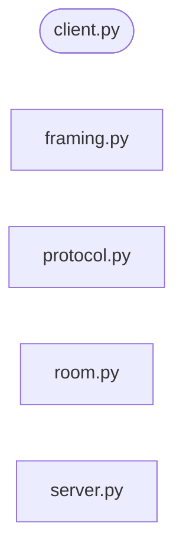

# b2_broadcast_crash

b2_broadcast_crash is a simple chat system that lets multiple users exchange messages through a command‑line client and an echo server. It demonstrates how to structure a Python project with modules for framing, protocol handling, and room management, making it useful for developers learning network programming and modular code organization.

## Run
```bash
python client.py
```

`client.py` options: `--host`, `--port`

Listens on port 5050.

## Architecture



More: [architecture](architecture.md).

## Code

- `client.py`: “Command-line chat client.”
- `framing.py`: “Length-prefixed frames: 4-byte big-endian length + UTF-8 body.”
- `protocol.py`: “Chat line protocol: slash commands.”
- `room.py`: “The chat room: connected clients by nickname.”
- `server.py`: “Line echo server for the chat project.”
