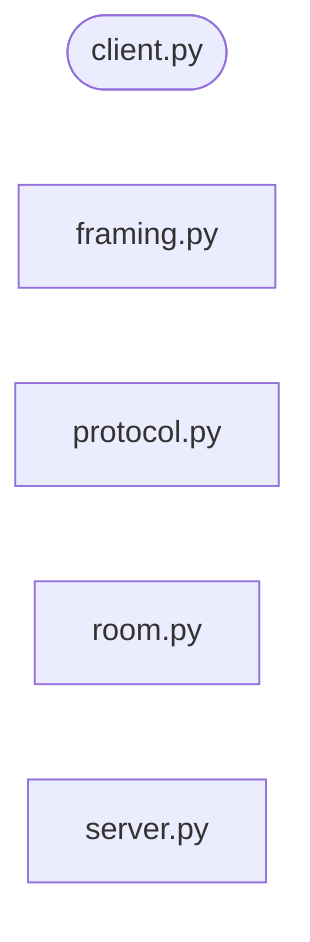

# Architecture: b2_broadcast_crash

The b2_broadcast_crash repository implements a simple chat system using a command‑line client (client.py) that connects to a line‑echo server (server.py). Messages are transmitted as length‑prefixed frames defined in framing.py, where each frame consists of a 4‑byte big‑endian length followed by a UTF‑8 body. The protocol for chat lines, including slash commands, is handled by protocol.py, while room.py maintains the set of connected clients identified by nickname. The application has no dependencies, listens on port 5050, and defines no endpoints or environment variables.

## Components

| Component | Modules | Lines | What it is |
|---|---|---|---|
| `client.py` | 1 | 18 | Command-line chat client. |
| `framing.py` | 1 | 18 | Length-prefixed frames: 4-byte big-endian length + UTF-8 body. |
| `protocol.py` | 1 | 17 | Chat line protocol: slash commands. |
| `room.py` | 1 | 33 | The chat room: connected clients by nickname. |
| `server.py` | 1 | 20 | Line echo server for the chat project. |
