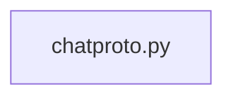

# Architecture: chatproto

The repository provides a tiny chat protocol implementation in the single module `chatproto.py`. It defines commands, ensures unique nicknames, and handles message framing for a TCP‑chat style application. The core functionality is implemented in functions such as `chatproto.py::parse_command` and format_message, which work together to process incoming data and construct outgoing messages. The accompanying test file validates these behaviors, confirming that the protocol correctly enforces nickname uniqueness and message structure.

## Components

| Component | Modules | Lines | What it is |
|---|---|---|---|
| `chatproto.py` | 1 | 73 | A tiny chat protocol (the kind of code the TCP-chat assignment asks for): commands, unique nicknames, message |
