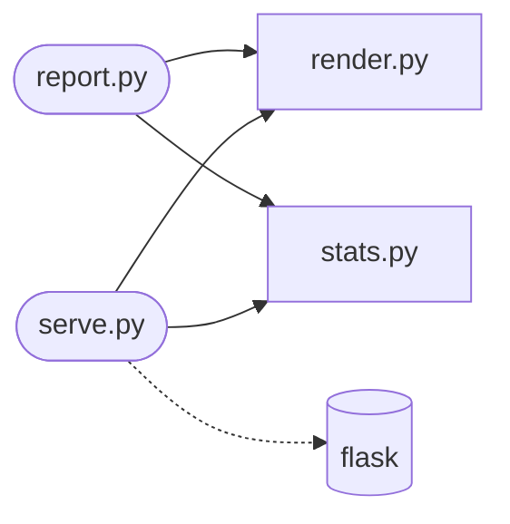

# csv_report

`csv_report` is a Python project designed to analyze CSV data and display formatted results. Numerical processing is handled by `stats.py`, which computes column statistics for input CSV files, while `render.py` turns those summaries into Markdown or HTML. Users can interact with the project via the command-line entry point `report.py` to summarize numeric columns, or serve a web view using `serve.py` over an HTTP endpoint. The codebase includes four modules, a command-line interface, one web endpoint, and one test file using pytest.

## Run
```bash
pip install -r requirements.txt
python report.py --input VALUE
python serve.py
```

`report.py` options: `--format` (md / html), `--input`, `--output`

## Configuration

| Variable | Default |
|---|---|
| `REPORT_CSV` | data.csv |

Listens on port 5001.

## Endpoints

| Endpoint | Defined in |
|---|---|
| GET /report | `serve.py` |

## Architecture



More: [architecture](architecture.md).

## Code

- `render.py`: “Turn a summary into Markdown or HTML.”
- `report.py`: “Command-line entry point: summarize the numeric columns of a CSV file.”
- `serve.py`: “Optional tiny web view of a report.”
- `stats.py`: “Column statistics for CSV files.”

## Tests

```bash
pytest
```
1 test file(s) with 1 test functions: `tests/test_stats.py`.
