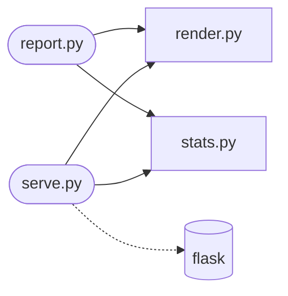

# Architecture: csv_report

`csv_report` is a Python project designed to analyze CSV data and display formatted results. Numerical processing is handled by `stats.py`, which computes column statistics for input CSV files, while `render.py` turns those summaries into Markdown or HTML. Users can interact with the project via the command-line entry point `report.py` to summarize numeric columns, or serve a web view using `serve.py` over an HTTP endpoint. The codebase includes four modules, a command-line interface, one web endpoint, and one test file using pytest.

## Components

| Component | Modules | Lines | What it is |
|---|---|---|---|
| `render.py` | 1 | 15 | Turn a summary into Markdown or HTML. |
| `report.py` | 1 | 25 | Command-line entry point: summarize the numeric columns of a CSV file. |
| `serve.py` | 1 | 21 | Optional tiny web view of a report. |
| `stats.py` | 1 | 30 | Column statistics for CSV files. |

Arrows are imports: `a --> b` means code in `a` imports `b` (every arrow is an import in the code).

## Libraries

- flask (declared >=3.0): used by `serve.py`
