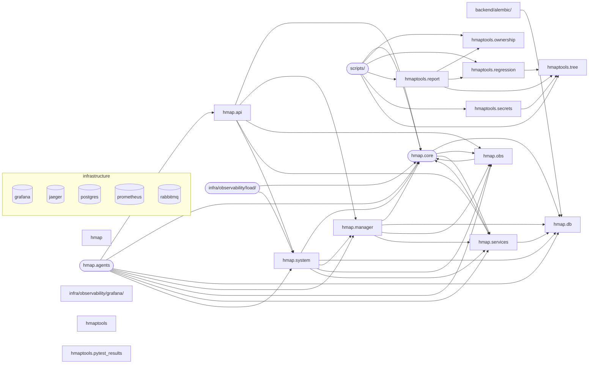

# hmap

hmap is a hierarchical multi‑agent AI execution platform that coordinates agents, tasks, and observability within a single‑process composition root. It enables developers and AI engineers to build, manage, and monitor complex agent‑driven workflows, providing built‑in support for task state machines, graph execution, and runtime tracing.

Requires Python 3.11 (`requires-python >=3.11,<3.12`).

## Run
```bash
make demo
make demo-replay
make api
make agents
make test
make check
hmap-agents
npm run dev
npm run build
python infra/observability/load/soak.py
```

`backend/src/hmap/agents/docgen/compile_report.py` options: `--out`

`backend/src/hmap/core/runtime/host.py` options: `--all`, `--heartbeat-s`, `--json`, `--only`

`infra/observability/load/soak.py` options: `--agents`, `--concurrency`, `--out`, `--projects`, `--real`, `--soak-minutes`, `--stub-delay`, `--timeout`

`scripts/demo_preflight.py` options: `--json`, `--mode` (live / replay)

`scripts/finetune_trial.py` options: `--iters`, `--lr`, `--max-seq`, `--num-layers`, `--source-model`, `--val-batches`

`scripts/make_handoff.py` options: `--dest`

`scripts/model_bakeoff.py` options: `--fix-rounds`, `--force`, `--model`, `--models`, `--only`, `--samples`, `--suites`, `--temperature`, `--think`

`scripts/ownership_check.py` options: `--base`, `--files`, `--member`

`scripts/precommit.py` options: `--base`, `--base-ref`, `--fast`, `--git-staged`, `--member`

`scripts/regression_check.py` options: `--base`, `--base-ref`, `--current`, `--member`, `--out`, `--reruns`

`scripts/security_check.py` options: `--offline`

## Configuration

| Variable | Default |
|---|---|
| `DEMO_MODE` | (not set) |
| `DEMO_OBS` | (not set) |
| `DEMO_PORT` | (not set) |
| `DEMO_SPLIT` | (not set) |
| `HF_HOME` | /Volumes/Tirth_SSD/hf_cache |
| `HMAP_AGENT_SECRETS` | (not set) |
| `HMAP_AGENT_TOKEN_TTL_S` | (not set) |
| `HMAP_ALLOW_REGISTRATION` | (not set) |
| `HMAP_API_WRITE_BURST` | 200 |
| `HMAP_API_WRITE_RATE` | 20 |
| `HMAP_ARTIFACT_ROOT` | (not set) |
| `HMAP_BUS` | (not set) |
| `HMAP_CLOUD_API_KEY` | (not set) |
| `HMAP_CLOUD_BASE_URL` | (not set) |
| `HMAP_CLOUD_OK` | (not set) |
| `HMAP_CLOUD_ROLE_MAP` | (not set) |
| `HMAP_CODING_CMD_TIMEOUT_S` | (not set) |
| `HMAP_CODING_KEEP_WORK` | (not set) |
| `HMAP_CODING_MAX_DEBUG_ROUNDS` | (not set) |
| `HMAP_CODING_MAX_REVISIONS` | (not set) |
| `HMAP_CODING_MAX_STEPS` | (not set) |
| `HMAP_CODING_PROMPT_TOKENS` | (not set) |
| `HMAP_CODING_PYTHON` | (not set) |
| `HMAP_CODING_SANDBOX` | (not set) |
| `HMAP_CODING_WORK_DIR` | (not set) |

… and 85 more environment variables (see the configuration reference).

Listens on port 3000 and port 3001 and port 4317 and port 4318.

## Endpoints

| Endpoint | Defined in |
|---|---|
| GET /api/agents | `backend/src/hmap/api/routers/system.py` |
| GET /api/agents/capabilities | `backend/src/hmap/api/routers/system.py` |
| POST /api/auth/forgot | `backend/src/hmap/api/routers/auth.py` |
| POST /api/auth/login | `backend/src/hmap/api/routers/auth.py` |
| POST /api/auth/logout | `backend/src/hmap/api/routers/auth.py` |
| POST /api/auth/logout-all | `backend/src/hmap/api/routers/auth.py` |
| GET /api/auth/me | `backend/src/hmap/api/routers/auth.py` |
| PATCH /api/auth/me | `backend/src/hmap/api/routers/auth.py` |
| POST /api/auth/password | `backend/src/hmap/api/routers/auth.py` |
| POST /api/auth/register | `backend/src/hmap/api/routers/auth.py` |
| POST /api/auth/reset | `backend/src/hmap/api/routers/auth.py` |
| POST /api/auth/ws-ticket | `backend/src/hmap/api/routers/auth.py` |
| GET /api/coding/heads/{project_id} | `backend/src/hmap/agents/coding/router.py` |
| GET /api/coding/runs/{project_id} | `backend/src/hmap/agents/coding/router.py` |
| GET /api/coding/runs/{project_id}/{task_id} | `backend/src/hmap/agents/refine/router.py` |
| GET /api/coding/runs/{project_id}/{task_id}/diff | `backend/src/hmap/agents/refine/router.py` |
| GET /api/coding/runs/{project_id}/{task_id}/files | `backend/src/hmap/agents/coding/router.py` |
| POST /api/coding/runs/{project_id}/{task_id}/revise | `backend/src/hmap/agents/coding/router.py` |
| GET /api/coding/runs/{project_id}/{task_id}/workspace.zip | `backend/src/hmap/agents/coding/router.py` |
| GET /api/dead-letters | `backend/src/hmap/api/routers/system.py` |
| GET /api/doc_intel/document-model/{project_id} | `backend/src/hmap/agents/doc_intel/router.py` |
| GET /api/doc_intel/pages/{project_id}/{artifact_id}/{page} | `backend/src/hmap/agents/doc_intel/router.py` |
| GET /api/doc_intel/requirements/{project_id} | `backend/src/hmap/agents/doc_intel/router.py` |
| PUT /api/doc_intel/requirements/{project_id} | `backend/src/hmap/agents/doc_intel/router.py` |
| GET /api/docgen/bundles/{project_id} | `backend/src/hmap/agents/docgen/router.py` |

… 59 more in [the API reference](api.md).

## Architecture



More: [architecture](architecture.md).

## Code

- `backend/alembic/env.py`: “Alembic environment for hmap.”
- `backend/src/hmap/__init__.py`: “hmap — hierarchical multi-agent AI project execution platform.”
- `backend/src/hmap/agents/__init__.py`: “hmap package.”
- `backend/src/hmap/agents/coding/__init__.py`: “Autonomous coding (Member 7, Sprint 7): ``code.implement`` + ``code.revise``.”
- `backend/src/hmap/agents/coding/agent.py`: “``CodingAgent`` (Sprint 7 item 7.9): the real ``code.implement`` and ``code.revise``.”
- `backend/src/hmap/agents/coding/context_budget.py`: “Context budgeter (Sprint 7 item 7.8, plan D10): every prompt fits ``HMAP_CODING_PROMPT_TOKENS``.”
- `backend/src/hmap/agents/coding/debug.py`: “Debug helpers (Sprint 7 item 7.7, plan D11): turn check output into located failures, score a round, and write the Reflexion note carried into the next round.”
- `backend/src/hmap/agents/coding/edits.py`: “SEARCH/REPLACE edit applicator (Sprint 7 item 7.5, plan D13; ported from ``samples/coding/edits.py``).”
- `backend/src/hmap/agents/coding/hooks.py`: “Manager hooks of the coding agent (Sprint 7, plan D16).”
- `backend/src/hmap/agents/coding/locate.py`: “Locator (Sprint 7 item 7.3, plan D9): which files does a task need to change?”
- `backend/src/hmap/agents/coding/loop.py`: “The coding loop (Sprint 7 items 7.6 / 7.7, plan D7, D11, D17, D18): understand → locate → plan → edit → check → debug, as a plain async state machine (no LangGraph).”
- `backend/src/hmap/agents/coding/model.py`: “Artifact types, ids and the coding trace (Sprint 7, plan D3).”
- `backend/src/hmap/agents/coding/package.py`: “Where a task's workspace starts (plan D1), and how its result is stored (D2, D3).”
- `backend/src/hmap/agents/coding/plugin.py`: “Member 7 plug-in: autonomous coding (Sprint 7).”
- `backend/src/hmap/agents/coding/prompts.py`: “Prompts for the coding loop (plan D10, D13, D19, D22).”
- `backend/src/hmap/agents/coding/repomap.py`: “Repository map (Sprint 7 item 7.2, plan D9): a compact, budgeted outline of the workspace for prompts.”
- `backend/src/hmap/agents/coding/review_hook.py`: “Self-review before returning (Sprint 7 item 7.11): Member 4's ``Refiner`` around the finished change.”
- `backend/src/hmap/agents/coding/revise.py`: “``code.revise`` inputs (Sprint 7 item 7.9, plan D14).”
- `backend/src/hmap/agents/coding/router.py`: “Coding API (Sprint 7 item 7.14), mounted at ``/api/coding``.”
- `backend/src/hmap/agents/coding/tools/__init__.py`: “The coding agent's tools (Sprint 7 item 7.4): files (read / list / search / write), edits, and checks run through the allow-listed :class:`~hmap.agents.coding.tools.runner.Runner`.”
- `backend/src/hmap/agents/coding/tools/checks.py`: “The agent's own checks (plan D12): compile, lint (errors only), the workspace's existing tests, and an import smoke test of the changed modules.”
- `backend/src/hmap/agents/coding/tools/files.py`: “Read-only file tools for prompts: read (whole file or a line window), list, search (Sprint 7 item 7.4).”
- `backend/src/hmap/agents/coding/tools/runner.py`: “Allow-listed command runner (Sprint 7 item 7.4, plan D5; ported from ``samples/coding/workspace.py``).”
- `backend/src/hmap/agents/coding/tools/sandbox.py`: “Which interpreter runs model-written code, and the best-effort macOS sandbox around it (plan D6, Q2/Q3).”
- `backend/src/hmap/agents/coding/workspace.py`: “Per-task workspace with a path jail (Sprint 7 item 7.1, ported from ``samples/coding/workspace.py``).”
- `backend/src/hmap/agents/doc_intel/__init__.py`: “Member 2 - document intelligence: uploaded documents -> a traceable RequirementSet (Sprint 2).”
- `backend/src/hmap/agents/doc_intel/agent.py`: “``DocIntelAgent`` (spec item 2.8): the real ``document.extract`` capability.”
- `backend/src/hmap/agents/doc_intel/cache.py`: “Small key -> text cache for expensive steps (vision OCR of a page, LLM extraction of a chunk), so a redelivered task or a re-run on the same document does no model work twice.”
- `backend/src/hmap/agents/doc_intel/chunking.py`: “Section-aligned chunks within a token budget (spec item 2.4).”
- `backend/src/hmap/agents/doc_intel/extract/__init__.py`: “Extraction: rule pre-pass, LLM per chunk, quote verification.”
- `backend/src/hmap/agents/doc_intel/extract/llm.py`: “LLM extraction per chunk (spec item 2.5): one schema-constrained ``reasoner`` call, the rule hits as hints, the answer cached by chunk text + prompt version.”
- `backend/src/hmap/agents/doc_intel/extract/quotes.py`: “Quote verification (spec §9 "quote required"): every extracted item must quote its source; the quote is looked up in the chunk's blocks.”
- `backend/src/hmap/agents/doc_intel/extract/rules.py`: “Rule pre-pass (spec item 2.5): keyword patterns find candidate requirements, constraints and deliverables with exact spans.”
- `backend/src/hmap/agents/doc_intel/loaders/__init__.py`: “Loaders (spec item 2.1): PDF (native or scanned), DOCX, text / Markdown and images, with per-page OCR gating.”
- `backend/src/hmap/agents/doc_intel/loaders/base.py`: “What every loader produces: an ordered list of :class:`RawBlock` per document (before ids and section paths are assigned by ``structure.py``), plus page info and warnings.”
- `backend/src/hmap/agents/doc_intel/loaders/docx.py`: “DOCX (python-docx): body paragraphs and tables in document order.”
- `backend/src/hmap/agents/doc_intel/loaders/pdf.py`: “Native PDF text with positions (pdfplumber) and page rendering for OCR (pypdfium2).”
- `backend/src/hmap/agents/doc_intel/loaders/text.py`: “Plain text and Markdown (also used for the vision model's page transcriptions, which are asked for Markdown).”
- `backend/src/hmap/agents/doc_intel/merge.py`: “Merge, dedup and ids (spec item 2.6).”
- `backend/src/hmap/agents/doc_intel/model.py`: “``DocumentModel``: the normalised view of every uploaded document (spec §4), stored as the ``document-model`` artifact so the UI can show each requirement's source and highlight it.”
- … 270 more modules (see the code summaries).

## Tests

```bash
pytest
npm run test
```
111 test file(s) with 820 test functions: `backend/tests/agents/stubs/test_stubs.py`, `backend/tests/api/test_api.py`, `backend/tests/api/test_auth.py`, `backend/tests/api/test_isolation.py`, `backend/tests/coding/test_agent_api.py`, `backend/tests/coding/test_edits_and_tools.py`, `backend/tests/coding/test_injection_repo.py`, `backend/tests/coding/test_integration_real.py` and 103 more.
