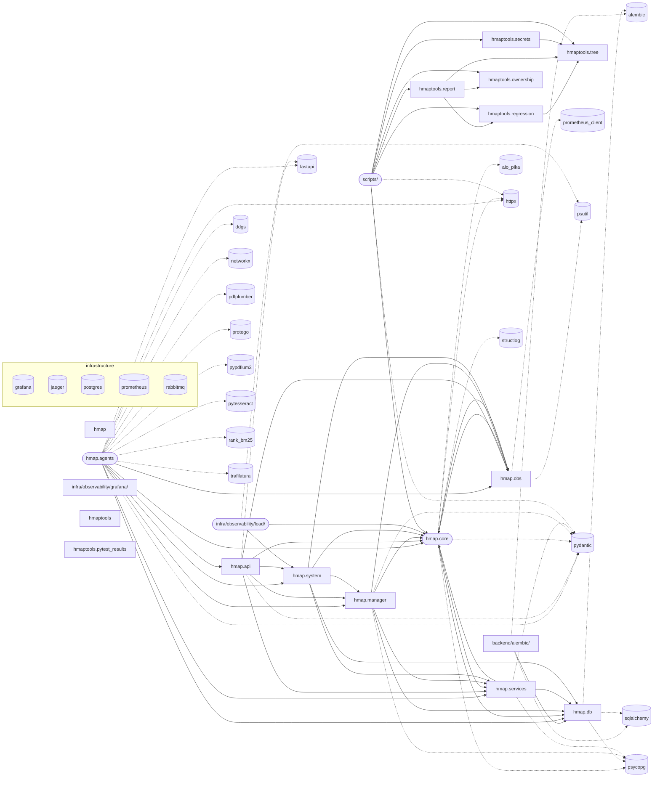
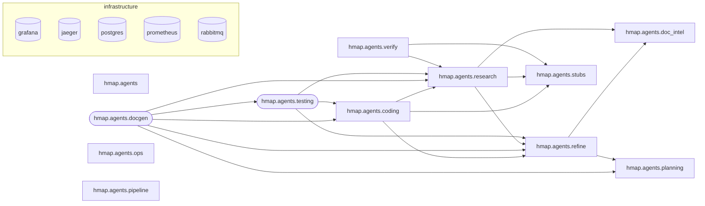
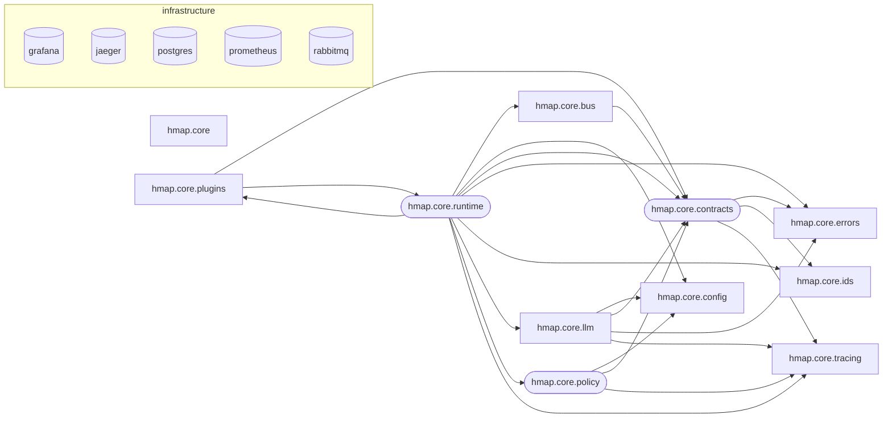
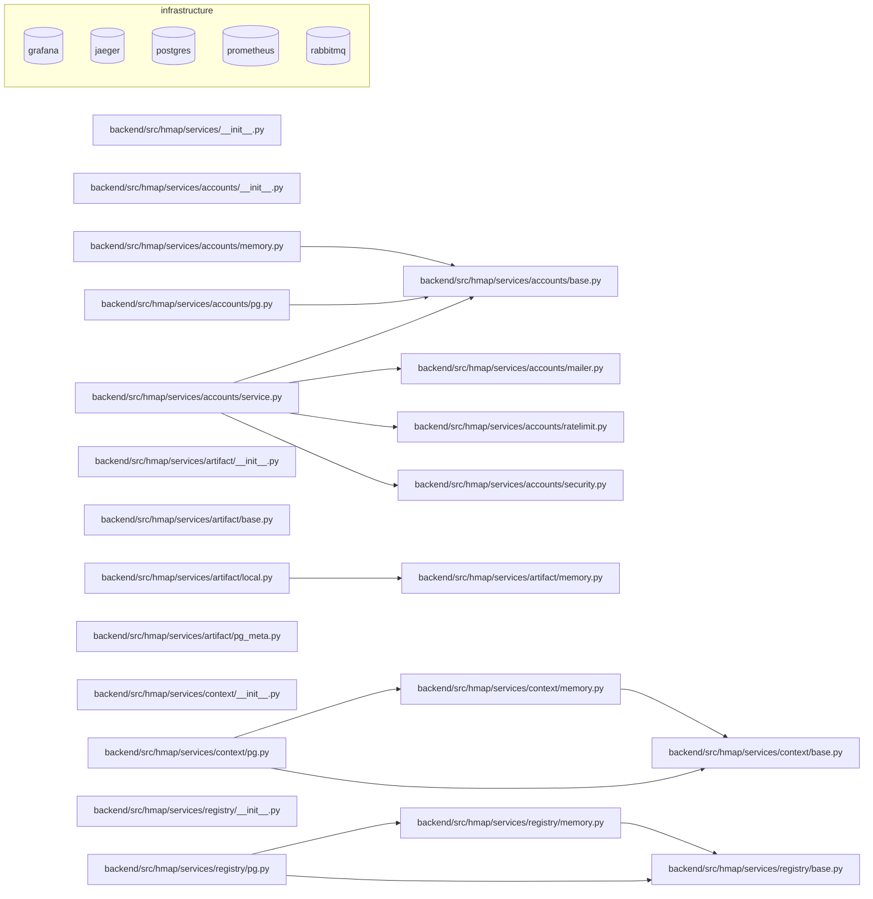
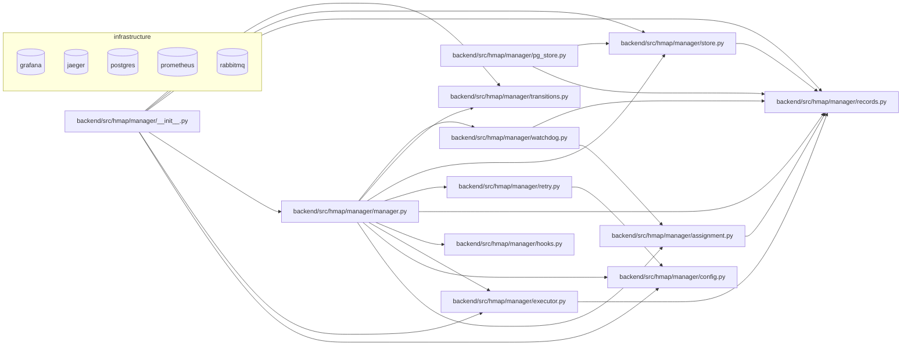
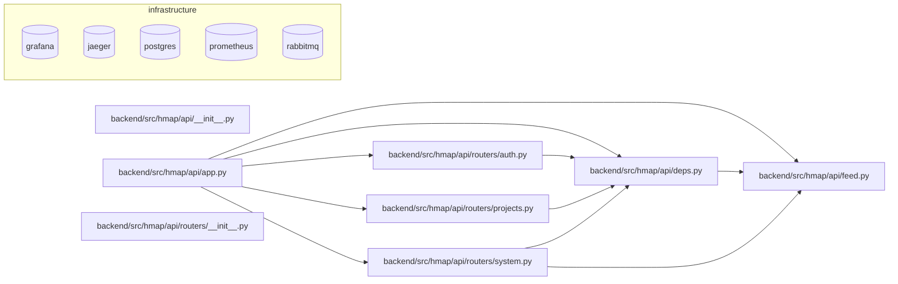
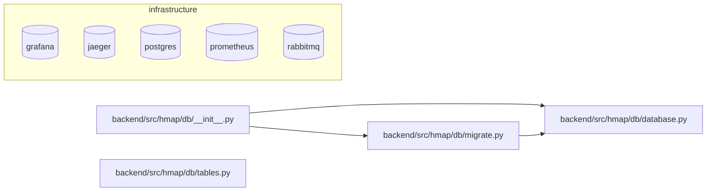
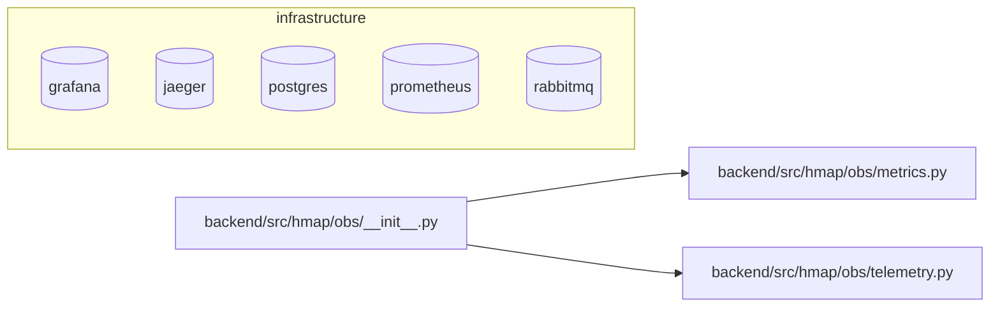

# Architecture: hmap

The hmap repository implements a hierarchical multi‑agent AI execution platform that coordinates agents, tasks, and observability across a single‑process composition root (backend/src/hmap/system.py::system). Core platform services live in hmap.core (e.g., backend/src/hmap/core/config.py::config and backend/src/hmap/core/runtime/base.py::base) and provide settings, error handling, tracing, and the agent plug‑in contract. Agents such as the documentation generator (backend/src/hmap/agents/docgen/model.py::model) and the testing sandbox (backend/src/hmap/agents/testing/sandbox/__init__.py::sandbox) use these contracts, while the manager (hmap.manager) runs the task state machine and graph executor. Persistence is handled by hmap.db (Postgres connection pool and migrations), and observability is provided by hmap.obs (traces and metrics). Supporting tooling in hmaptools (e.g., hmaptools.report::report) enables regression checks, ownership validation, and secret scanning across the 310 modules and 84 HTTP endpoints.

## Components

| Component | Modules | Lines | What it is |
|---|---|---|---|
| `backend/alembic/` | 1 | 74 | Alembic environment for hmap. |
| `hmap` | 1 | 3 | hmap — hierarchical multi-agent AI project execution platform. |
| `hmap.agents` | 181 | 24074 | hmap package. |
| `hmap.api` | 8 | 1016 | hmap package. |
| `hmap.core` | 46 | 7621 | Platform core (owner: Member 1). Other members import from here but never edit it (doc 01 §2). |
| `hmap.db` | 4 | 524 | Postgres persistence (Sprint 1 item 1.5): connection pool, schema (``tables``) and migrations (``migrate``). |
| `hmap.manager` | 12 | 2348 | Manager core (owner: Member 1): task state machine, task store, assignment, retries, watchdog, graph executor. |
| `hmap.obs` | 3 | 517 | Observability (Member 4, Sprint 4 §5b): traces, metrics, and the helpers the platform calls at a few points. |
| `hmap.services` | 22 | 1500 | hmap package. |
| `hmap.system` | 1 | 190 | Composition root: builds the whole platform in one process. |
| `infra/observability/grafana/` | 1 | 110 | Writes ``dashboards/hmap.json`` (the committed Grafana dashboard, Sprint 4 item 4.17). Edit the panel list here and |
| `infra/observability/load/` | 1 | 169 | Load / soak test (Sprint 4 item 4.20; reused by Member 11's release gate): N projects at once on the stub agents. |
| `scripts/` | 22 | 2944 | Cloud key-pool check (doc 02 §2.5): does every cloud route in the role map still answer, and which keys work? |
| `hmaptools` | 1 | 1 | Team tooling (owner: Member 1): tree manifests, ownership checks, regression attribution. Standard library only. |
| `hmaptools.ownership` | 1 | 75 | Map changed files to owners using ownership.toml and flag edits outside a member's own paths. |
| `hmaptools.pytest_results` | 1 | 33 | Tiny pytest plug-in (no dependencies): writes {nodeid: outcome} to $HMAP_RESULTS_JSON. |
| `hmaptools.regression` | 1 | 165 | Regression attribution: run the same test suite on a BASE tree and on the CURRENT tree and classify every test. |
| `hmaptools.report` | 1 | 131 | Markdown + JSON report for a regression check (attach it to the commit / handoff). |
| `hmaptools.secrets` | 1 | 45 | Secret scan: fail if anything that looks like a real API key / private key is in the project tree. |
| `hmaptools.tree` | 1 | 92 | Snapshot a project tree as {relative_path: sha256} so two folders (or a folder and a git ref) can be compared |

Arrows are imports: `a --> b` means code in `a` imports `b` (every arrow is an import in the code).

## Inside `hmap.agents`

- `hmap.agents`: hmap package.
- `hmap.agents.coding`: Autonomous coding (Member 7, Sprint 7): ``code.implement`` + ``code.revise``. See ``docs/members/7/``.
- `hmap.agents.doc_intel`: Member 2 - document intelligence: uploaded documents -> a traceable RequirementSet (Sprint 2).
- `hmap.agents.docgen`: Technical documentation agent (Member 9, Sprint 9): ``docs.generate`` / ``docs.update``.
- `hmap.agents.ops`: Operations plug-in (Member 4, Sprint 4): explain failures, list dead letters, replay them explicitly.
- `hmap.agents.pipeline`: Default project pipeline (owner: Member 1).
- `hmap.agents.planning`: Member 3 (Sprint 3): planning and task decomposition — RequirementSet -> validated TaskGraph, the layer-parallel
- `hmap.agents.refine`: Self-reflection and refinement library (Member 4, Sprint 4). Public interface (spec §7):
- `hmap.agents.research`: Autonomous research (Member 5, Sprint 5): ``research.run`` -> a cited ``ResearchReport``. Plan:
- `hmap.agents.stubs`: hmap package.
- `hmap.agents.testing`: Member 8: automated testing & execution (Sprint 8). See ``plugin.py``.
- `hmap.agents.verify`: Member 6 (Sprint 6): research verification — ``verify.claims``. See ``docs/members/6/``.

## Inside `hmap.core`

- `hmap.core`: Platform core (owner: Member 1). Other members import from here but never edit it (doc 01 §2).
- `hmap.core.bus`: Message bus (owner: Member 1). See base.py for the interface and semantics.
- `hmap.core.config`: Settings read from the environment (see /.env.example). One place, so nothing reads os.environ ad hoc.
- `hmap.core.contracts`: Cross-process contracts (owner: Member 1). Import from here, e.g. ``from hmap.core.contracts import TaskAssign``.
- `hmap.core.errors`: Error taxonomy (research §25) and the retry classifier (§23).
- `hmap.core.ids`: Identifier helpers.
- `hmap.core.llm`: LLM gateway (doc 01 §4, doc 02 §2). Agents depend only on :class:`LLMClient`; get one with
- `hmap.core.plugins`: Plug-in declaration and discovery (Sprint 1 §3.5). Every member package exposes ``hmap/agents/<name>/plugin.py``
- `hmap.core.policy`: Basic security layer (Sprint 6 item 6.20, owner Member 6; was Sprint 1 item 1.18) and token lifecycle (6.15).
- `hmap.core.runtime`: hmap package.
- `hmap.core.tracing`: W3C ``traceparent`` propagation (research §11) and structured JSON logging.

## Inside `hmap.services`

- `backend/src/hmap/services/__init__.py`: hmap package.
- `backend/src/hmap/services/accounts/__init__.py`: User accounts: sign-up, sessions, password reset (Member 1).
- `backend/src/hmap/services/accounts/base.py`: User accounts, sessions and password-reset tokens: records + the store interface (memory and Postgres).
- `backend/src/hmap/services/accounts/mailer.py`: Outgoing account email (password reset).
- `backend/src/hmap/services/accounts/memory.py`: In-memory account store (tests and ``HMAP_STORE=memory``; forgets everything on restart).
- `backend/src/hmap/services/accounts/pg.py`: Account store in PostgreSQL (tables ``users``, ``sessions``, ``password_resets`` — migration ``001b``).
- `backend/src/hmap/services/accounts/ratelimit.py`: Small in-process sliding-window rate limiter for login, registration and password-reset requests.
- `backend/src/hmap/services/accounts/security.py`: Password hashing and opaque tokens (standard library only).
- `backend/src/hmap/services/accounts/service.py`: Account use cases: register, sign in/out, sessions, profile, password change and reset, WebSocket tickets.
- `backend/src/hmap/services/artifact/__init__.py`: hmap package.
- `backend/src/hmap/services/artifact/base.py`: Artifact store interface (research §15, Sprint 1 item 1.11). Implementation: ``LocalFSArtifactStore``
- `backend/src/hmap/services/artifact/local.py`: ``LocalFSArtifactStore``: write-once files under ``HMAP_ARTIFACT_ROOT`` (Sprint 1 item 1.11, research §15).
- `backend/src/hmap/services/artifact/memory.py`: In-memory ``ArtifactStore`` (tests, Phase A) plus helpers shared with ``LocalFSArtifactStore``.
- `backend/src/hmap/services/artifact/pg_meta.py`: Artifact metadata in Postgres (Sprint 1 item 1.11, research §15/§18): the ``artifacts`` table, unique
- `backend/src/hmap/services/context/__init__.py`: hmap package.
- `backend/src/hmap/services/context/base.py`: Context service interface (research §13-14, Sprint 1 item 1.10). Immutable versioned snapshots; assignments
- `backend/src/hmap/services/context/memory.py`: In-memory ``ContextStore`` (Sprint 1 item 1.10, research §13-14). Postgres ``contexts`` table in Phase B.
- `backend/src/hmap/services/context/pg.py`: Postgres ``ContextStore`` (Sprint 1 item 1.10; research §13-14) on the ``contexts`` table (PK
- `backend/src/hmap/services/registry/__init__.py`: hmap package.
- `backend/src/hmap/services/registry/base.py`: Agent registry interface (research §19-21, Sprint 1 item 1.9). Manager-owned projection: advisory for
- `backend/src/hmap/services/registry/memory.py`: In-memory agent registry (Sprint 1 item 1.9; research §16, §19-21).
- `backend/src/hmap/services/registry/pg.py`: Postgres agent registry (Sprint 1 item 1.9; research §16, §19-21) on the ``agents`` table. Same behaviour as

## Inside `hmap.manager`

- `backend/src/hmap/manager/__init__.py`: Manager core (owner: Member 1): task state machine, task store, assignment, retries, watchdog, graph executor.
- `backend/src/hmap/manager/assignment.py`: Agent selection for READY tasks (research §20, §27). Pure functions; the Manager applies the result.
- `backend/src/hmap/manager/config.py`: Manager tunables (research §23 defaults).
- `backend/src/hmap/manager/executor.py`: Graph executor strategy (Sprint 1 item 1.13). Decides which tasks of a project may start, which are blocked, and
- `backend/src/hmap/manager/hooks.py`: Plug-in hook dispatch and strategy-slot resolution (Sprint 1 §3.5).
- `backend/src/hmap/manager/manager.py`: The Manager (Sprint 1 item 1.13): owns task state, assigns work, consumes agent reports, retries, times out,
- `backend/src/hmap/manager/pg_store.py`: Postgres ``TaskStore`` (Sprint 1 items 1.5/1.8; research §17, §18, §22, §34). Same behaviour as
- `backend/src/hmap/manager/records.py`: Manager-owned persistent records (research §34). Mirrors the Postgres tables of item 1.5; the in-memory store
- `backend/src/hmap/manager/retry.py`: Retry policy (research §23, §25, §26): what to do with a failed execution.
- `backend/src/hmap/manager/store.py`: Task store (research §17, §24, §34): projects, tasks, executions, approvals + the outbox, written together.
- `backend/src/hmap/manager/transitions.py`: Task state machine (Sprint 1 item 1.6; research §9, §12, §17, §18).
- `backend/src/hmap/manager/watchdog.py`: Watchdog decisions (research §21, §25, §26, §35): ack timeouts and abandoned executions. Pure functions over

## Inside `hmap.api`

- `backend/src/hmap/api/__init__.py`: hmap package.
- `backend/src/hmap/api/app.py`: FastAPI application (Sprint 1 item 1.15).
- `backend/src/hmap/api/deps.py`: FastAPI dependencies: the running system lives on ``app.state``; the signed-in user comes from the session cookie.
- `backend/src/hmap/api/feed.py`: Live event feed for the UI: subscribes to every domain event (``#``), keeps a bounded history (snapshot for
- `backend/src/hmap/api/routers/__init__.py`: Core API routers (Member 1). Members' routers come from their plug-ins and are mounted at /api/<plugin>.
- `backend/src/hmap/api/routers/auth.py`: Accounts API: register, sign in/out, profile, password change, password reset, WebSocket tickets.
- `backend/src/hmap/api/routers/projects.py`: Projects, runs, documents, plans, approvals, tasks and artifacts (Sprint 1 item 1.15) — all owner-scoped.
- `backend/src/hmap/api/routers/system.py`: Agents, capabilities, events, dead letters, health (Sprint 1 item 1.15) + the live WebSocket.

## Inside `hmap.db`

- `backend/src/hmap/db/__init__.py`: Postgres persistence (Sprint 1 item 1.5): connection pool, schema (``tables``) and migrations (``migrate``).
- `backend/src/hmap/db/database.py`: Async Postgres access for the ``pg_*`` stores: URL helpers + a small psycopg 3 connection pool.
- `backend/src/hmap/db/migrate.py`: Programmatic Alembic: migrate on start, and test helpers.
- `backend/src/hmap/db/tables.py`: SQLAlchemy Core table models of the Sprint 1 schema (mirrors ``alembic/versions/001_sprint_1_core.py``).

## Inside `hmap.obs`

- `backend/src/hmap/obs/__init__.py`: Observability (Member 4, Sprint 4 §5b): traces, metrics, and the helpers the platform calls at a few points.
- `backend/src/hmap/obs/metrics.py`: Metrics (Sprint 4 item 4.17, plan D14/D17): Prometheus counters, histograms and gauges in one registry.
- `backend/src/hmap/obs/telemetry.py`: Traces (Sprint 4 item 4.15, plan D11/D13/D17): OpenTelemetry spans exported over OTLP/HTTP to Jaeger v2.

## Libraries

- aio_pika (declared >=9.4): used by `hmap.core`
- alembic (declared >=1.13): used by `backend/alembic/`, `hmap.db`
- ddgs (declared >=9.16,<9.17): used by `hmap.agents`
- fastapi (declared >=0.115): used by `hmap.agents`, `hmap.api`
- httpx (declared >=0.27): used by `hmap.agents`, `hmap.core`, `scripts/`
- networkx (declared ==3.6.1): used by `hmap.agents`
- pdfplumber (declared >=0.11): used by `hmap.agents`
- prometheus_client (declared >=0.26,<0.27): used by `hmap.obs`
- protego (declared >=0.7,<0.8): used by `hmap.agents`
- psutil (declared >=7.2,<8): used by `hmap.obs`, `infra/observability/load/`
- psycopg (declared >=3.2): used by `hmap.core`, `hmap.db`, `hmap.manager`, `hmap.services`
- pydantic (declared >=2.7,<3): used by `hmap.agents`, `hmap.api`, `hmap.core`, `hmap.manager`, `hmap.services`, `scripts/`
- pypdfium2 (declared >=4.30): used by `hmap.agents`
- pytesseract (declared >=0.3.13): used by `hmap.agents`
- rank_bm25 (declared ==0.2.2): used by `hmap.agents`
- sqlalchemy (declared >=2.0): used by `backend/alembic/`, `hmap.db`
- structlog (declared >=24.1): used by `hmap.core`
- trafilatura (declared ==2.2.0): used by `hmap.agents`

## Infrastructure

Docker compose services: `grafana`, `jaeger`, `postgres`, `prometheus`, `rabbitmq`.
