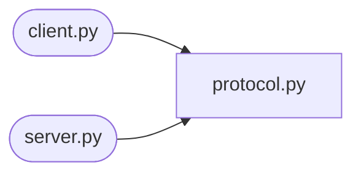

# tcp_chat

The `tcp_chat` repository implements a command-line chat system using a custom line protocol defined in `protocol.py` for handling commands and length-prefixed frames. The system relies on a threaded TCP chat server managed by `server.py`, which handles one thread per connected client, enforces unique nicknames, and manages message broadcasting. Users connect to this server via the command-line interface provided in `client.py`. Additionally, the repository includes a test suite that uses pytest to verify the project's functionality.

## Run
```bash
pip install -r requirements.txt
python client.py --nick VALUE
python server.py
```

`client.py` options: `--host`, `--nick`, `--port`

## Configuration

| Variable | Default |
|---|---|
| `CHAT_MAX_CLIENTS` | 32 |
| `CHAT_PORT` | 5050 |

Listens on port 5050.

## Architecture



More: [architecture](architecture.md).

## Code

- `client.py`: “Command-line chat client.”
- `protocol.py`: “Line protocol for the chat: commands and length-prefixed frames.”
- `server.py`: “Threaded TCP chat server: one thread per client, unique nicknames, broadcast.”

## Tests

```bash
pytest
```
1 test file(s) with 2 test functions: `tests/test_protocol.py`.
