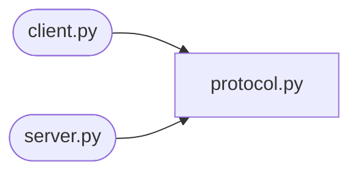

# Architecture: tcp_chat

The `tcp_chat` repository implements a command-line chat system using a custom line protocol defined in `protocol.py` for handling commands and length-prefixed frames. The system relies on a threaded TCP chat server managed by `server.py`, which handles one thread per connected client, enforces unique nicknames, and manages message broadcasting. Users connect to this server via the command-line interface provided in `client.py`. Additionally, the repository includes a test suite that uses pytest to verify the project's functionality.

## Components

| Component | Modules | Lines | What it is |
|---|---|---|---|
| `client.py` | 1 | 32 | Command-line chat client. |
| `protocol.py` | 1 | 38 | Line protocol for the chat: commands and length-prefixed frames. |
| `server.py` | 1 | 69 | Threaded TCP chat server: one thread per client, unique nicknames, broadcast. |

Arrows are imports: `a --> b` means code in `a` imports `b` (every arrow is an import in the code).
