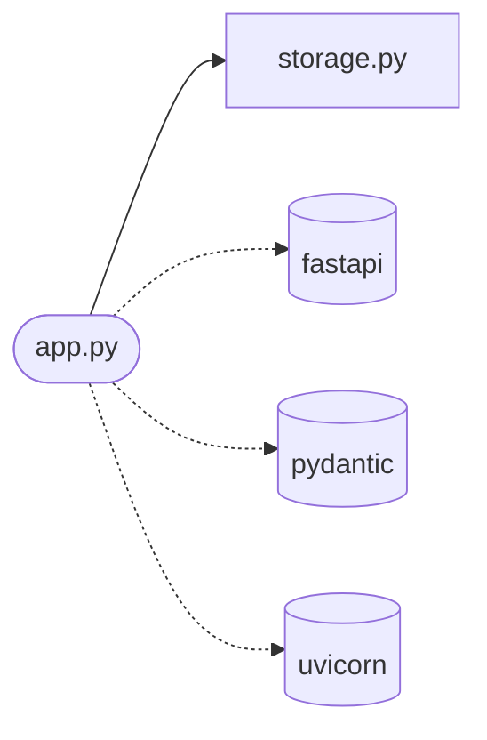

# todo_api

The todo_api project provides a simple REST API for managing to‑do items. It is designed for developers who need a lightweight, test‑driven example of CRUD operations in a Python web service. The repository includes the API implementation, a SQLite storage layer, and a test suite to verify functionality.

Requires Python 3.11 (`requires-python >=3.11`).

## Run
```bash
pip install -e ".[dev]"
python app.py
```

## Configuration

| Variable | Default |
|---|---|
| `TODO_DB_PATH` | todos.db |
| `TODO_PORT` | 8000 |

Listens on port 8000.

## Endpoints

| Endpoint | Defined in |
|---|---|
| GET /health | `app.py` |
| GET /todos | `app.py` |
| POST /todos | `app.py` |
| DELETE /todos/{todo_id} | `app.py` |
| GET /todos/{todo_id} | `app.py` |

## Architecture



More: [architecture](architecture.md).

## Code

- `app.py`: “To-do REST API.”
- `storage.py`: “SQLite storage for to-do items.”

## Tests

```bash
pytest
```
1 test file(s) with 1 test functions: `tests/test_storage.py`.
