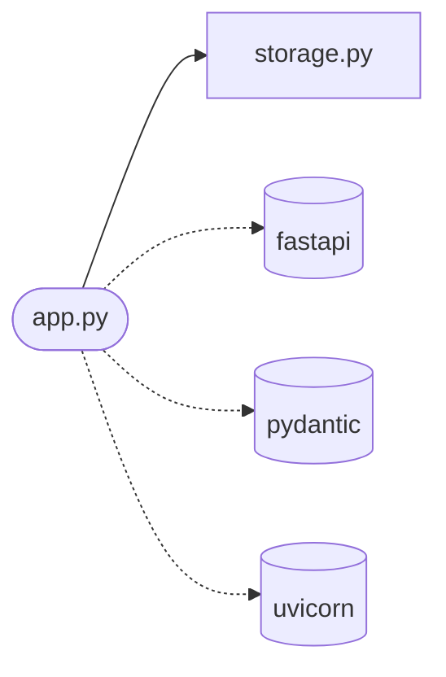

# Architecture: todo_api

The `todo_api` repository is a Python application that implements a REST API for managing to-do items using `fastapi` and `uvicorn`. The application's five HTTP endpoints are defined in `app.py`, while data persistence is managed by an SQLite database layer in `storage.py`. Data validation across the system uses `pydantic`. Furthermore, the repository includes a test suite in one test file that leverages `pytest` and `httpx` to ensure the API functions correctly.

## Components

| Component | Modules | Lines | What it is |
|---|---|---|---|
| `app.py` | 1 | 48 | To-do REST API. |
| `storage.py` | 1 | 32 | SQLite storage for to-do items. |

Arrows are imports: `a --> b` means code in `a` imports `b` (every arrow is an import in the code).

## Libraries

- fastapi (declared ==0.115.6): used by `app.py`
- pydantic (declared >=2.9): used by `app.py`
- uvicorn (declared ==0.34.0): used by `app.py`
