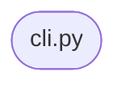

# Architecture: tpl_cli

The `tpl_cli` project provides a command-line interface skeleton implemented as a Python project. Its main entry point is defined in `cli.py::main`, which receives arguments, executes a chosen subcommand, and returns an exit code. The repository is structured around a single module, `cli.py`, and includes a single test file to support the codebase.

## Components

| Component | Modules | Lines | What it is |
|---|---|---|---|
| `cli.py` | 1 | 45 | Command-line tool skeleton: ``main(argv)`` parses arguments, runs one subcommand and returns an exit code. |
