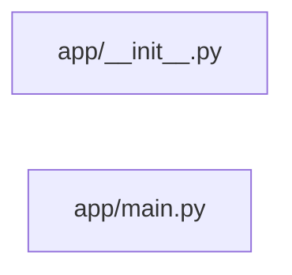

# tpl_fastapi_service

This repository provides a minimal Python HTTP service skeleton with a health‑check endpoint (GET /health) and simple in‑memory CRUD endpoints for items (POST /items, GET /items/{item_id}). It is intended for developers who need a lightweight starting point for building and testing basic web services without external dependencies.

## Endpoints

| Endpoint | Defined in |
|---|---|
| GET /health | `app/main.py` |
| POST /items | `app/main.py` |
| GET /items/{item_id} | `app/main.py` |

## Architecture



More: [architecture](architecture.md).

## Code

- `app/__init__.py`: app/__init__.py initializes the app package, providing no public functions or classes.
- `app/main.py`: “HTTP service skeleton: a health route and a small in-memory CRUD resource.”

## Tests

```bash
pytest
```
1 test file(s) with 2 test functions: `tests/test_main.py`.
