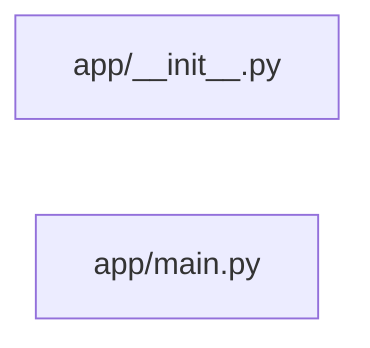

# Architecture: tpl_fastapi_service

The `tpl_fastapi_service` repository provides a Python HTTP service skeleton featuring a health check route and a basic in-memory CRUD resource. The application structure is initialized by `app/__init__.py`, which sets up the internal package without defining public functions or classes. Core API endpoints and service logic are implemented in `app/main.py` across the project's two modules. Overall project behavior is verified by a single test file using the standard library.

## Components

| Component | Modules | Lines | What it is |
|---|---|---|---|
| `app/__init__.py` | 1 | 1 |  |
| `app/main.py` | 1 | 39 | HTTP service skeleton: a health route and a small in-memory CRUD resource. |
