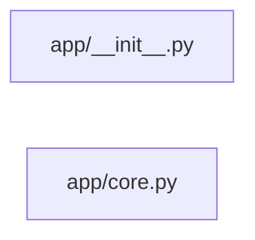

# tpl_python_package

The tpl_python_package project provides a structured Python package designed to separate core execution logic from input and output operations. By keeping these concerns separate, the core functions can be reliably tested, making the repository a solid foundation for developers who need a clean, testable Python project layout.

## Architecture



More: [architecture](architecture.md).

## Code

- `app/__init__.py`: “The project's package.”
- `app/core.py`: “Core logic of the package.”

## Tests

```bash
pytest
```
1 test file(s) with 2 test functions: `tests/test_core.py`.
