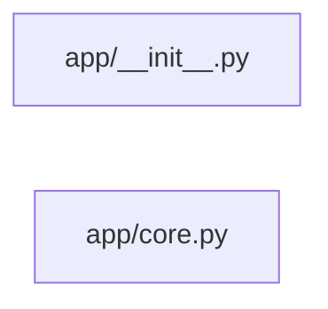

# Architecture: tpl_python_package

The `tpl_python_package` repository provides a Python package structured to separate core execution logic from input and output. The primary implementation resides in `app/core.py`, while `app/__init__.py` defines the package and contains module logic designed for testing. Keeping `app/__init__.py` free of input and output operations enables the repository's single test file to reliably call its functions.

## Components

| Component | Modules | Lines | What it is |
|---|---|---|---|
| `app/__init__.py` | 1 | 3 | The project's package. Put the logic in modules here; keep them free of input/output so tests can call them. |
| `app/core.py` | 1 | 6 | Core logic of the package. |
