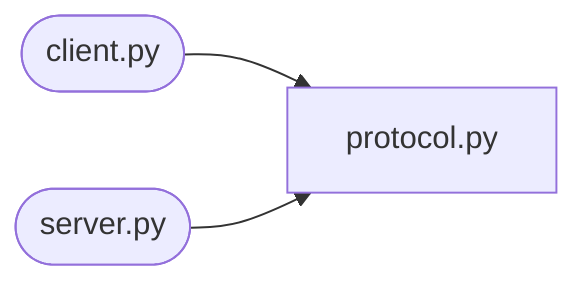

# tpl_tcp_server_client

This project implements a simple TCP chat system that lets multiple users communicate in real time. It is designed for developers who need a lightweight, standard‑library‑only example of client‑server messaging in Python.

## Run
```bash
python client.py
python server.py
```

`client.py` options: `--host`, `--port`

`server.py` options: `--host`, `--port`

Listens on port 5000.

## Architecture



More: [architecture](architecture.md).

## Code

- `client.py`: “TCP chat client: lines typed on stdin are sent to the server; messages from the server are printed.”
- `protocol.py`: “Wire format: UTF-8 text messages, one per line (``\n``-terminated).”
- `server.py`: “Multi-client TCP chat server: every client is served on its own thread at the same time, and each message a client sends is broadcast to every other connected client.”

## Tests

```bash
pytest
```
1 test file(s) with 5 test functions: `test_chat.py`.
