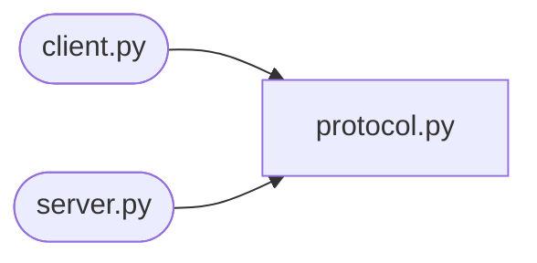

# Architecture: tpl_tcp_server_client

The tpl_tcp_server_client repository implements a simple TCP chat system using only the standard library. The `client.py::main` function reads lines from stdin, sends them to the server, and prints any incoming messages, while MAX_LINE defines the maximum allowed line length for the UTF‑8, newline‑terminated wire format. The handle_client routine runs each connection in its own thread, broadcasting each received message to all other connected clients. Together, the protocol module defines the message format, the client module provides the user interface, and the server module manages multi‑client communication.

## Components

| Component | Modules | Lines | What it is |
|---|---|---|---|
| `client.py` | 1 | 57 | TCP chat client: lines typed on stdin are sent to the server; messages from the server are printed. |
| `protocol.py` | 1 | 31 | Wire format: UTF-8 text messages, one per line (``\n``-terminated). Lines longer than MAX_LINE are refused. |
| `server.py` | 1 | 117 | Multi-client TCP chat server: every client is served on its own thread at the same time, and each message a |

Arrows are imports: `a --> b` means code in `a` imports `b` (every arrow is an import in the code).
