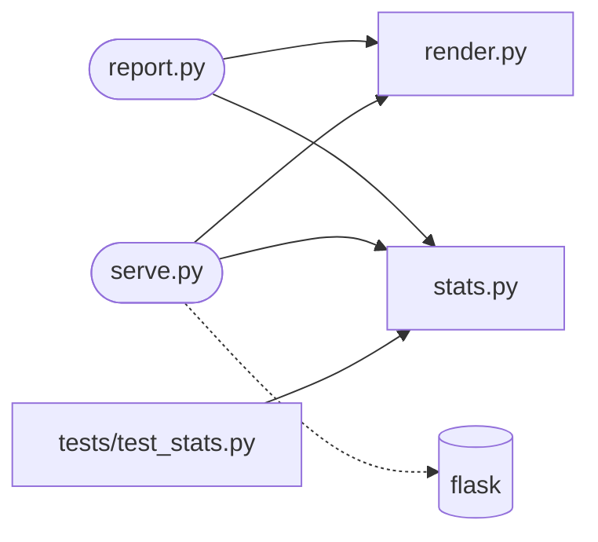

# csv_report

<!-- prose: one paragraph written by the model from the facts below -->

## Run
```bash
pip install -r requirements.txt
python report.py --input VALUE
python serve.py
```

`report.py` options: `--input`, `--output`, `--format` (md / html)

## Configuration
| Variable | Default |
|---|---|
| `REPORT_CSV` | data.csv |

Listens on port 5001.

## Endpoints
| Endpoint | Defined in |
|---|---|
| GET /report | `serve.py` |

## Code


- `render.py`: `to_markdown()`, `to_html()`
- `report.py`: `main()`
- `serve.py`: `report()`
- `stats.py`: `load()`, `numeric_columns()`, `summarize()`, `is_number()`

## Tests
```bash
pytest
```
1 test file(s): `tests/test_stats.py`.
