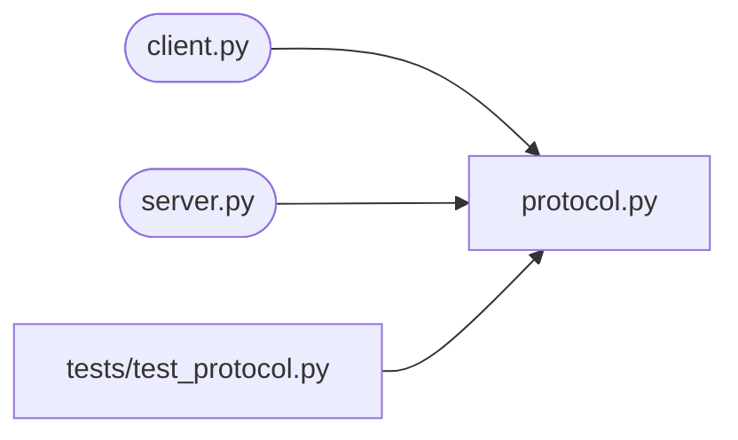

# tcp_chat

<!-- prose: one paragraph written by the model from the facts below -->

## Run
```bash
pip install -r requirements.txt
python client.py --nick VALUE
python server.py
```

`client.py` options: `--host`, `--port`, `--nick`

## Configuration
| Variable | Default |
|---|---|
| `CHAT_PORT` | 5050 |
| `CHAT_MAX_CLIENTS` | 32 |

Listens on port 5050.

## Code


- `client.py`: `receive()`, `main()`
- `protocol.py`: `parse_command()`, `frame()`, `unframe()`
- `server.py`: `handle_client()`, `serve()`, `join()`, `leave()`, `broadcast()`

## Tests
```bash
pytest
```
1 test file(s): `tests/test_protocol.py`.
