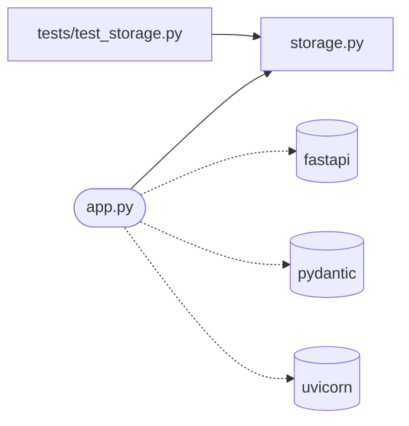

# todo_api

<!-- prose: one paragraph written by the model from the facts below -->

Requires Python 3.11 (`requires-python >=3.11`).

## Run
```bash
pip install -e ".[dev]"
python app.py
```

## Configuration
| Variable | Default |
|---|---|
| `TODO_PORT` | 8000 |
| `TODO_DB_PATH` | todos.db |

Listens on port 8000.

## Endpoints
| Endpoint | Defined in |
|---|---|
| GET /health | `app.py` |
| GET /todos | `app.py` |
| POST /todos | `app.py` |
| GET /todos/{todo_id} | `app.py` |
| DELETE /todos/{todo_id} | `app.py` |

## Code


- `app.py`: `health()`, `list_all()`, `create()`, `read()`, `delete()`
- `storage.py`: `connect()`, `add_todo()`, `list_todos()`, `get_todo()`, `delete_todo()`

## Tests
```bash
pytest
```
1 test file(s): `tests/test_storage.py`.
